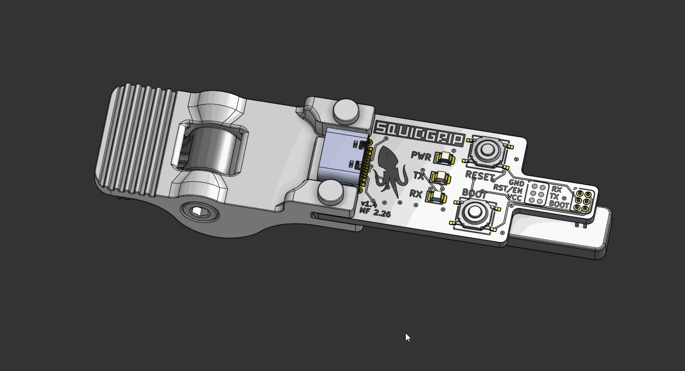
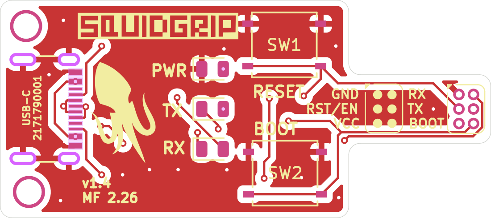
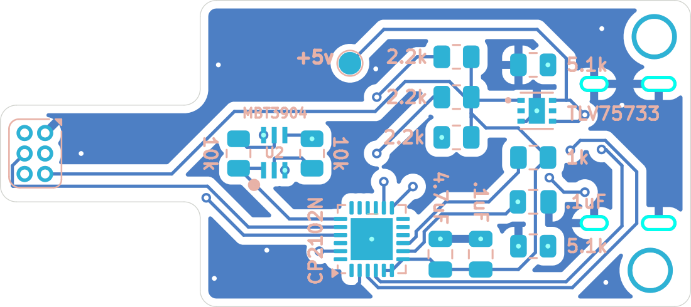
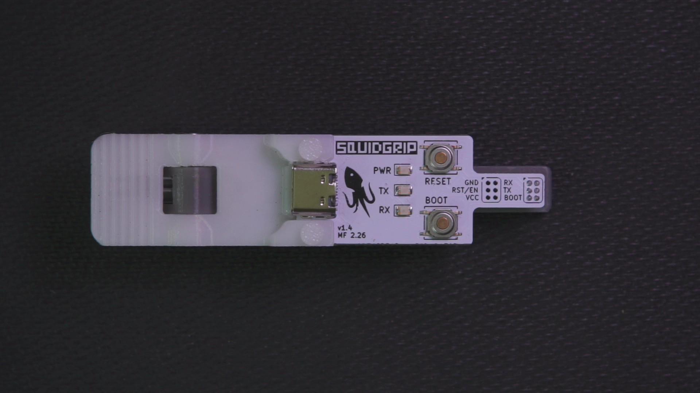
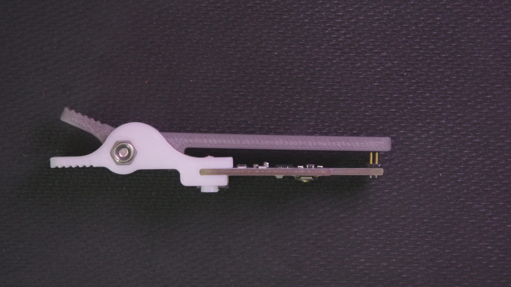
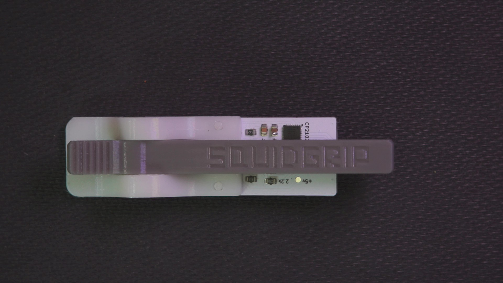
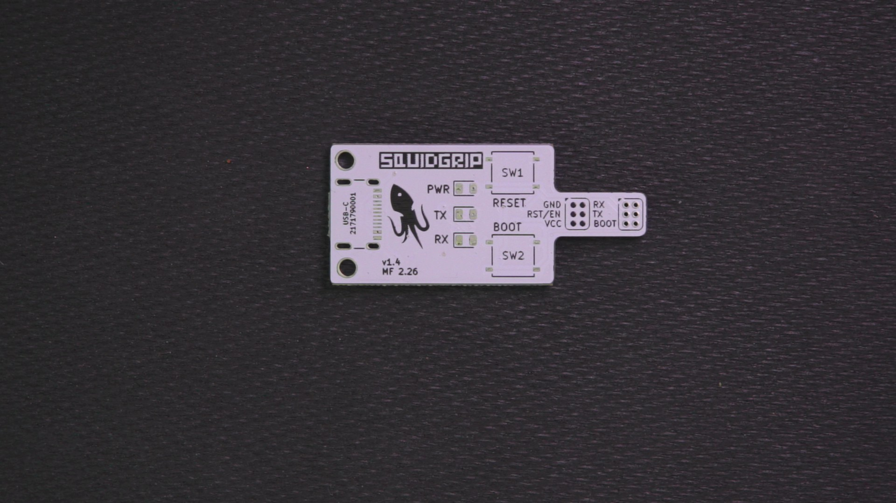
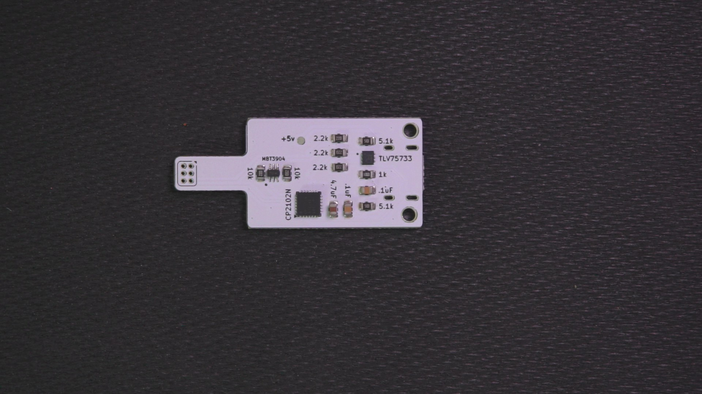
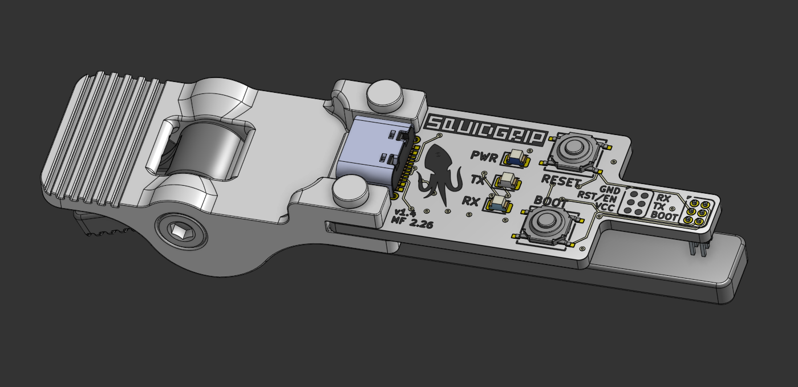

# SquidGrip

SquidGrip is a clamp-on USB-UART probe for programming ESP32 boards. It is a CP2102N on a small
USB-C board with a 6-pin pogo pin array on a thin tongue, plus a 3D printed clamp that presses that
tongue onto the programming pads of a target board.

It carries the ESP32 auto-reset circuit, so esptool, the ExpressLRS Configurator, PlatformIO, Arduino
IDE, etc can drop a target into the bootloader and flash it without you touching anything. There
are RESET and BOOT buttons for doing it by hand, power/TX/RX LEDs, and a 3.3 V LDO so the probe can
power the board it is flashing.

<p align="center">
  
  <br>
  <em>SquidGrip in the clamp (3D render)</em>
  <br><br>
  
  
  <br>
  <em>Copper and silkscreen: front and rear</em>
  <br><br>
  
  
  
  <br>
  <em>Assembled: front, side and rear</em>
  <br><br>
  
  
  
  <br>
  <em>Bare PCB front and rear, and the CAD assembly</em>
</p>

## Contents

- [Features](#features)
- [Specs](#specs)
- [How it works](#how-it-works)
- [Pinout](#pinout)
- [Configuring the CP2102N](#configuring-the-cp2102n)
- [Using it](#using-it)
- [The clamp](#the-clamp)
- [Bill of materials](#bill-of-materials)
- [Manufacturing](#manufacturing)
- [Repo layout](#repo-layout)
- [License](#license)

## Features

- CP2102N USB-UART bridge on USB-C. It shows up as a normal serial port, no drivers needed on
  Windows 10 or newer, macOS and Linux.
- The one-time CP2102N configuration is in `firmware/`, so a clone comes up with a proper name
  instead of as a generic bridge.
- ESP32 auto-reset circuit (a dual transistor driven by DTR and RTS), so flashing tools can put the
  target into the bootloader on their own.
- RESET and BOOT buttons for manual control.
- Power, TX and RX LEDs.
- 6-pin pogo array on a thin tongue, 2x3 at 1.27 mm pitch, so you can reach a small pad
  array on a crowded board. Or get a 90 degree header for even tighter access.
- 3.3 V LDO on board: the probe can power the target while flashing, no second supply needed.
- 3D printed clamp (upper jaw, lower jaw, pivot pin) that holds the pogo pins on the target pads.
- 42.75 x 19.00 mm, 2 layers, 1.6 mm FR-4.
## Specs

| Item | Value |
| --- | --- |
| USB | USB-C receptacle (Molex 2171790001), USB 2.0 only, 5.1 kΩ CC pulldowns |
| USB-UART bridge | Silicon Labs CP2102N-A02-GQFN24 (QFN-24) |
| Regulator | TLV75733, 3.3 V out from USB 5 V |
| Programming pins | 6 pogo pins on a 2x3 array at 1.27 mm pitch (Mill-Max 855-22-006-30-001101) |
| Auto reset | MBT3904DW1T1G dual NPN plus two 10 kΩ resistors, driven by DTR and RTS |
| Buttons | RESET (SW1) and BOOT (SW2), C&K PTS526 SM15 SMTR2 LFS |
| LEDs | PWR (blue), TX (yellow), RX (green) |
| Board | 42.75 x 19.00 mm, 2 layers, 1.51 mm FR-4 core, 1 oz copper, about 1.6 mm total |
| Mounting | 2 x M2 holes plus the 3D printed clamp |
| Clamp parts | `clamp_upper.step`, `clamp_lower.step`, `pin.step` |

## How it works

```
   USB-C ─────▶ +5V ─────▶ TLV75733 ─────▶ +3.3V ─────▶ pogo VCC (powers the target)
     │                        (3.3 V LDO)
     │ D+ / D-
     ▼
  CP2102N ── TXD ──▶ pogo RX   (target RXD0)
     │    ── RXD ◀── pogo TX   (target TXD0)
     │
     │ DTR / RTS
     ▼
  MBT3904 (dual NPN) ──▶ pogo RST/EN (target EN) and pogo BOOT (target IO0)

  SW1 = RESET, SW2 = BOOT, D1/D2/D3 = PWR/TX/RX LEDs
```

The auto-reset part is the standard ESP32 arrangement: DTR and RTS from the CP2102N drive two
transistors through 10 kΩ resistors, which pull EN low and hold IO0 low in the right order. That is
the same trick an ESP32 dev board uses, so esptool and friends can reset the target into the
bootloader by themselves. The buttons do the same job by hand if you need them.

The CP2102N runs off the 3.3 V rail (VREGIN, VDD and VIO are all tied to +3.3 V), senses USB VBUS on
+5 V, and has a 1 kΩ pull-up on its reset pin.

Main connections on U1:

| U1 pin | Name | Net |
| --- | --- | --- |
| 3, 4 | D+, D- | USB data from J1 |
| 8 | VBUS | +5V |
| 5, 6, 7 | VIO, VDD, VREGIN | +3.3V |
| 9 | ~RST | R5 1 kΩ pull-up to +3.3V |
| 20, 21 | RXD, TXD | pogo TX (pad 5), pogo RX (pad 6) |
| 19, 23 | ~RTS, ~DTR | auto-reset transistors (U2) |
| 13, 14 | ~TXT, ~RXT | RX and TX LED cathodes |
| 2, 25 | GND | GND |

## Pinout

Six pins, 2x3 array at 1.27 mm pitch. One column is GND / RST-EN / VCC and the other is
RX / TX / BOOT, and the silkscreen labels match the layout. TX and RX are named from the *target's*
point of view, so the pin marked RX is the one the probe drives and the pin marked TX is the one the
probe reads.

| Silk | Pad | Net | Probe side | Target side |
| --- | --- | --- | --- | --- |
| GND | 1 | `GND` | ground | ground |
| RST/EN | 2 | `/RESET` | auto-reset transistor, SW1 | EN (reset) |
| VCC | 3 | `+3.3V` | 3.3 V from the LDO | 3V3 |
| BOOT | 4 | `/BOOT` | auto-reset transistor, SW2 | IO0 (boot select) |
| TX | 5 | `/RXD` | CP2102N RXD (input) | target TXD0 |
| RX | 6 | `/TXD` | CP2102N TXD (output) | target RXD0 |

To put it on your own board: 6 pads, 1 mm diameter, 0.54 mm holes, 1.27 mm pitch, in a 2x3 block with
that pinout. It is in this repo as `hardware/squidgrip_pogo_2x03_P1.27mm.kicad_mod`, and the
[SquidTX Nano](https://github.com/unixvoid/SquidTX-Nano-ELRS) TX board carries it as SG1, so the two
work together out of the box.
## Configuring the CP2102N

The CP2102N leaves the factory with a generic identity, so it needs a one-time configuration before
the probe behaves like a SquidGrip. That configuration is in `firmware/`, and Silicon Labs' own tool
programs it.

**Tool:** [Simplicity Studio](https://www.silabs.com/developers/simplicity-studio) with the
**Xpress Configurator**. The `firmware/` folder is a Simplicity Studio project, and its settings file
pins the exact part (`ffd.usbxpress.cp2102n.cp2102n_a02_gqfn24`).

| File | What it is |
| --- | --- |
| `firmware/.project`, `firmware/.settings/` | Simplicity Studio project metadata, so the folder opens straight in the IDE |
| `firmware/squidgrip.document` | the device configuration document |
| `firmware/squidgrip.configuration` | the saved configuration: `FilterVidPid` 10C4:EA60 plus the config byte array |

Steps:

1. Install Simplicity Studio, then plug the SquidGrip into USB-C.
2. Open the `firmware/` project, or make a new Xpress Configurator project and open its document file.
3. Use **Import From Device** to read the chip's current configuration, then set the fields you want.
   The one that matters is the **Product String**, because that is the name your OS shows for the
   port (set it to `SquidGrip`). The manufacturer string and serial number are also there.
4. Click **Program to Device**.
5. Unplug and replug the probe. It comes up under the new name.

The configuration keeps Silicon Labs' VID/PID (10C4:EA60) instead of a custom one, and that is
deliberate: the stock VCP driver matches it, so there are no `.inf` edits and no driver install. If
you change the VID/PID you are on your own for driver matching.

Two notes from Silicon Labs' documentation. If Simplicity Studio does not pick up the new name after
programming, clear its device cache: delete the device's `.info` file from
`SimplicityStudio/<workspace>/.metadata/.plugins/com.silabs.ss.platform.device.core/device` and
replug. And if the product string in `squidgrip.configuration` is still Silicon Labs' default
(`CP2102N USB to UART Bridge Controller`), then that is the field to change in step 3.

## Using it

1. Plug the SquidGrip into USB. The blue PWR LED lights up and a serial port appears. The CP2102N
   needs no drivers on Windows 10 or newer, macOS and Linux.
2. Line the tongue up with the pad array on the target board and close the clamp. The pogo pins point
   down from the underside of the tongue, so the target sits below it.
3. Flash. The auto-reset circuit does the reset and boot pin dance for you, so anything that talks to
   a serial port works: the ExpressLRS Configurator (pick the target, set the upload method to UART,
   choose the COM port, Build & Flash), PlatformIO, the Arduino IDE, or plain esptool, for example:

   ```
   esptool.py --chip esp32 --port COM5 --baud 921600 write_flash 0x0 firmware.bin
   ```

The TX and RX LEDs blink with traffic, so you can see whether the target is answering. If a tool
cannot get the target into the bootloader, do it by hand: hold BOOT, tap RESET, release BOOT.

Two things worth knowing:

- The probe feeds 3.3 V to the target through the VCC pin, so a bare board can be flashed with
  nothing else connected. If the target already has its own supply, be aware the two will be tied
  together.
- The 3.3 V rail comes from the TLV75733 and USB VBUS, so what you can pull depends on the USB port
  you are plugged into. It is plenty for an ESP32 (and an RF module while flashing).

## The clamp

It works like an alligator clip. Three printed parts in `hardware/clamp_design/`:

| File | Part | Qty |
| --- | --- | --- |
| `squidgrip - clamp_upper.step` | upper jaw (SQUIDGRIP embossed on it) | 1 |
| `squidgrip - clamp_lower.step` | lower jaw | 1 |
| `squidgrip - pin.step` | pins that connect the PCB to the print | 2 |

Hardware:

| Part | McMaster-Carr | Qty |
| --- | --- | --- |
| M3 x 16 mm socket head cap screw | 91292A115 | 1 |
| M3 nyloc nut | 93625A100 | 1 |
| Spring (in the handle) | 9271K577 | 2 |

The two printed pins hold the PCB to the clamp, the M3 screw and nyloc nut are the pivot, and the two
springs sit in the handle so the jaws spring back open. The target board goes between the jaws, under
the tongue. The one in the photos is FDM printed, so print settings are up to you. `squidgrip.step`
in `hardware/manufacturing/` is the finished assembly if you want to check clearances before
printing.

## Bill of materials

Parts that LCSC can assemble (this is the CSV in `hardware/manufacturing/`):

| Ref | Value / Part | Package | LCSC |
| --- | --- | --- | --- |
| U1 | CP2102N-A02-GQFN24R | QFN-24 4x4 | C969151 |
| U2 | MBT3904DW1T1G | SOT-363 | C110150 |
| U3 | TLV75733PDRVR | WSON-6 2x2 | C2868428 |
| C1 | 4.7 µF | 0805 | C1779 |
| C2, C3 | 0.1 µF | 0805 | C1711 |
| R1, R8 | 10 kΩ | 0805 | C17414 |
| R5 | 1 kΩ | 0805 | C17513 |
| R6, R7 | 5.1 kΩ | 0805 | C27834 |
| R9, R10, R11 | 2.2 kΩ | 0805 | C17520 |

Everything else is hand soldered:

| Ref | Part | Notes |
| --- | --- | --- |
| J1 | Molex 2171790001 | USB-C receptacle |
| SG1 | Mill-Max 855-22-006-30-001101 | 6-position pogo pin header |
| SW1, SW2 | C&K PTS526 SM15 SMTR2 LFS | RESET and BOOT switches |
| D1, D2, D3 | 0805 LEDs, yellow / green / blue | TX, RX, PWR |
| - | 2 x M2 screws | PCB to clamp |
| - | pivot pin or screw for the hinge | see `hardware/clamp_design/` |
## Manufacturing

| File | Description |
| --- | --- |
| `hardware/squidgrip.kicad_pro` | KiCad project (design rules and netclass) |
| `hardware/squidgrip.kicad_sch` | schematic (title block: Squidgrip ESP32 Interface, rev 1.4, Midnight CAD) |
| `hardware/squidgrip.kicad_pcb` | PCB layout |
| `hardware/manufacturing/squidgrip-v1.4-gerbers.zip` | gerber and drill package, ready to upload |
| `hardware/manufacturing/gerbers/` | the same files unpacked (F and B Cu, mask, paste, silk, Edge_Cuts, PTH and NPTH drills, job) |
| `hardware/manufacturing/squidgrip_v1.4_BOM.csv` | BOM with LCSC part numbers, in the JLCPCB assembly format |
| `hardware/manufacturing/squidgrip.step` | 3D model of the assembled board |
| `hardware/clamp_design/` | clamp STEP files |
| `hardware/squidgrip_pogo_2x03_P1.27mm.kicad_mod` | the 6-pin pogo footprint on its own, for your own boards |
| `docs/` | photos, layer renders and the CAD image used here |

Fab options that match the layout:

- 2 layers, 1.6 mm FR-4, 1 oz copper (1.51 mm core plus 2 x 0.035 mm copper).
- 0.1524 mm minimum track and clearance, 0.2 mm netclass tracks with 0.16 mm clearance, 0.6 mm vias
  with a 0.3 mm drill, 0.5 mm copper to the board edge. Those are the values in the project file.
- ENIG is worth the extra if you want the pogo pads and the USB-C shell to hold up.
- The USB-C receptacle, pogo header, switches and LEDs are hand soldered, so order those yourself
  along with the LCSC parts.

## Repo layout

```
.
├── README.md
├── LICENSE                      # CERN-OHL-S-2.0
├── docs/
│   ├── squidgrip.gif                    # 3D render of the assembly
│   ├── squidgrip_assembled_front.jpg    # photo, assembled front
│   ├── squidgrip_assembled_side.jpg     # photo, side view in the clamp
│   ├── squidgrip_assembled_rear.jpg     # photo, assembled rear
│   ├── squidgrip_pcb_front.jpg          # photo, bare PCB front
│   ├── squidgrip_pcb_rear.jpg           # photo, bare PCB rear
│   ├── squidgrip_assembly_cad.png       # CAD view of the assembly
│   ├── squidgrip_copper_front.png       # KiCad render, front copper and silk
│   └── squidgrip_copper_rear.png        # KiCad render, rear copper and silk
├── firmware/
│   ├── squidgrip.configuration          # CP2102N configuration
│   ├── squidgrip.document               # Xpress Configurator device document
│   ├── .project                         # Simplicity Studio project
│   └── .settings/                       # Simplicity Studio tool settings
└── hardware/
    ├── squidgrip.kicad_pro      # KiCad project
    ├── squidgrip.kicad_sch      # schematic
    ├── squidgrip.kicad_pcb      # PCB layout
    ├── squidgrip_pogo_2x03_P1.27mm.kicad_mod   # the 6-pin pogo footprint
    ├── clamp_design/
    │   ├── squidgrip - clamp_upper.step
    │   ├── squidgrip - clamp_lower.step
    │   └── squidgrip - pin.step
    └── manufacturing/
        ├── squidgrip-v1.4-gerbers.zip
        ├── squidgrip.step
        ├── squidgrip_v1.4_BOM.csv
        └── gerbers/             # unpacked gerbers and drill files
```

## License

SquidGrip is licensed under the CERN Open Hardware Licence Version 2 - Strongly Reciprocal
(CERN-OHL-S-2.0). The full licence text is in [`LICENSE`](LICENSE).

```
Copyright (C) 2026 Midnight CAD / SquidTX

This source describes Open Hardware and is licensed under the CERN-OHL-S v2.

You may redistribute and modify this source and make products using it under
the terms of the CERN-OHL-S v2 (https://ohwr.org/cern_ohl_s_v2.txt).

This source is distributed WITHOUT ANY EXPRESS OR IMPLIED WARRANTY, INCLUDING
OF MERCHANTABILITY, SATISFACTORY QUALITY AND FITNESS FOR A PARTICULAR PURPOSE.
Please see the CERN-OHL-S v2 for applicable conditions.

Source location: https://github.com/unixvoid/squidgrip
```